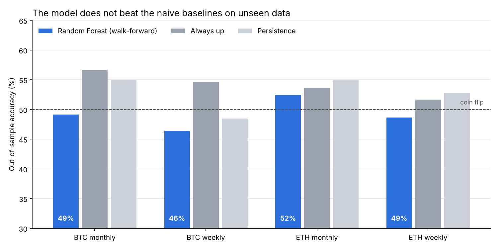

# Can Technical Indicators Predict Crypto Price Direction?

An exploratory study of Bitcoin (BTC-USD) and Ethereum (ETH-USD) price data. I tested whether price-derived signals (moving averages, RSI, MACD, Bollinger Bands and ~80 other indicators) carry enough information to predict the direction of the next candle. I then started extending the work with social-media sentiment.

**Short answer: no.** A Random Forest scores 100% on its own training data but only **46–52% on unseen data**, below a naive "always predict up" baseline for both coins on both monthly and weekly candles. The main lesson of this project is about *evaluation*, not prediction.



---

## Question

> Given only historical price and volume data, can a model predict whether the next candle's close will be higher or lower than the current one?

## Main result: Random Forest with walk-forward validation

Notebook: [`BTC/indicatorbasedprediction.ipynb`](BTC/indicatorbasedprediction.ipynb)

**Setup**
- **Data:** daily OHLCV from Yahoo Finance (BTC from 2014, ETH from 2017), resampled to monthly and weekly candles. The current, still-incomplete candle is dropped.
- **Features:** all indicators from `ta.add_all_ta_features`, computed without back-filling so no future values leak into early rows.
- **Target:** `1` if the next close is higher than the current close, otherwise `0`.
- **Evaluation:** walk-forward. For each period, the model is trained only on earlier periods and then predicts that period (expanding window; 24 months or 104 weeks of initial training).
- **Baselines:** *always up*, *persistence* (same direction as the current candle), and a 50% coin flip.

**Results** (out-of-sample accuracy)

| Setup | Test periods | Training accuracy | Random Forest | Always up | Persistence | p-value (RF > 50%) |
|---|---:|---:|---:|---:|---:|---:|
| BTC monthly | 120 | 100% | **49.2%** | 56.7% | 55.0% | 0.61 |
| BTC weekly | 526 | 100% | **46.4%** | 54.6% | 48.5% | 0.96 |
| ETH monthly | 82 | 100% | **52.4%** | 53.7% | 54.9% | 0.37 |
| ETH weekly | 362 | 100% | **48.6%** | 51.7% | 52.8% | 0.72 |

*Data up to October 2026. Results will shift slightly when the notebook is re-run on newer data.*

**What this shows**
1. **Training accuracy is meaningless here.** With ~80 features and 100–600 samples, the model memorises the history. An earlier version of this project reported that 100% as its result, which was the key mistake this version corrects.
2. **On unseen data the model is at coin-flip level** and never beats the simplest baseline. None of the results is statistically better than 50%.
3. **Technical indicators alone gave no usable signal** for the next monthly or weekly candle. This is consistent with markets already pricing in public price information.

## Other experiments

| Notebook | Approach | Status |
|---|---|---|
| `BTC/mlprediction on btc_usd_chart.ipynb` | 20/50-day SMA crossover, projected 60 days ahead (Bitstamp BTC/USD daily CSV) | Complete, but see note |
| `BTC/csvX.ipynb` | LSTM on 7-day sequences of price + daily tweet sentiment (DistilBERT, Kaggle Bitcoin tweets) | Pipeline written, not validated |
| `BTC/XLIVE.ipynb` | Same LSTM, fed with live X (Twitter) posts | Archived: X API access unavailable |

**SMA crossover projection.** The notebook extends both moving averages along straight lines from their latest slope, so its 60-day forecast ("Down" every day) mostly repeats the current trend by construction. Extrapolating indicators is not prediction; a backtest against buy-and-hold would be the correct way to evaluate this rule.

**Sentiment (LSTM + DistilBERT).** The hypothesis was that price lacks the information that moves crypto markets: news and crowd sentiment. The pipeline is written but has known issues that must be fixed before any result can be trusted:
- `distilbert-base-uncased` has no sentiment head; a fine-tuned checkpoint such as `distilbert-base-uncased-finetuned-sst-2-english` is needed.
- The `MinMaxScaler` is fitted on all data before the train/validation split, which leaks future information.
- The 30-day price window is too small for an LSTM and must match the date range of the tweet dataset.

## Conclusions

- Price-derived indicators did not predict the direction of the next monthly or weekly candle better than naive baselines.
- For time series, only out-of-sample (walk-forward) evaluation is meaningful; in-sample accuracy is misleading.
- If a signal exists, it is more likely in external information (news, sentiment, on-chain data) than in candles. That is the direction of the sentiment notebooks.

## Next steps

- Fix and evaluate the sentiment pipeline with the same walk-forward method and baselines.
- Backtest the SMA crossover rule against buy-and-hold instead of projecting it.

## Tech stack

Python · pandas · NumPy · scikit-learn · SciPy · TensorFlow/Keras · Hugging Face Transformers · `ta` · yfinance · tweepy · matplotlib · Jupyter / Google Colab

## Running

```bash
pip install yfinance ta scikit-learn scipy matplotlib jupyter
jupyter notebook BTC/indicatorbasedprediction.ipynb
```

The main notebook downloads its own data and runs in about 4 minutes. `mlprediction on btc_usd_chart.ipynb` and `csvX.ipynb` were written for Google Colab and read CSV files from Google Drive; adjust the paths to run them locally (they also need `tensorflow transformers joblib`). `XLIVE.ipynb` needs X API credentials.

## Disclaimer

Learning project, not financial advice. No trading was done based on these models.

## License

MIT, see [LICENSE](LICENSE).
